<div align="center">

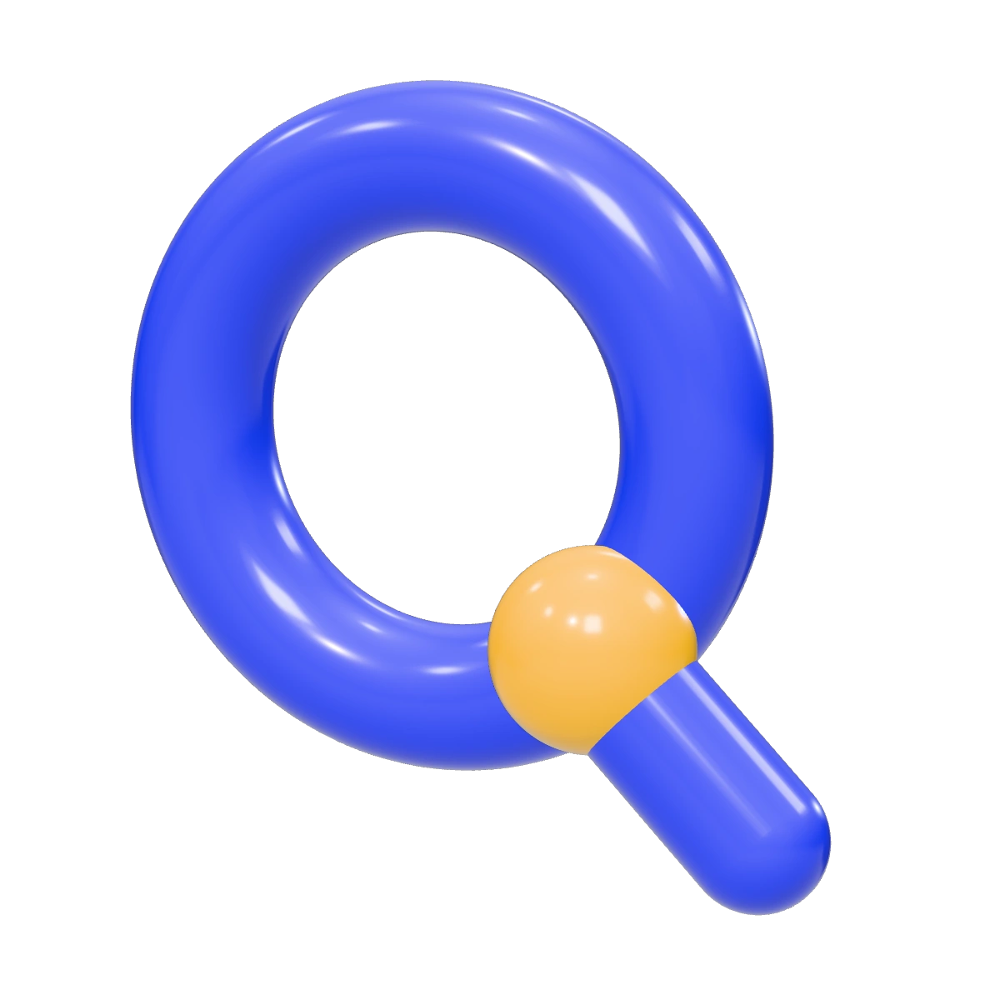

# Qolda

**Check one elbow-extension rep at home. The video never leaves your computer.**

*SerIQ case · AI-Sana Shakarim Solveathon 2026*

**English** · [Русский](README.ru.md)


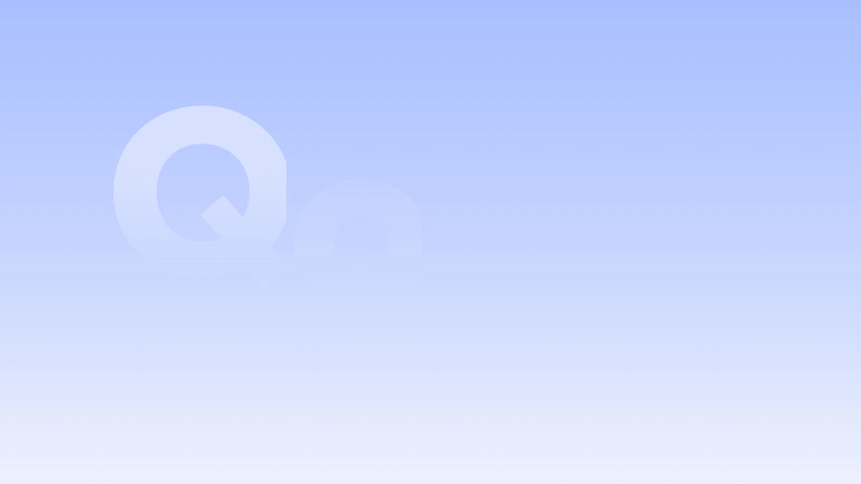

<sub>Real run: a validation clip from the public dataset fills the card, a scan line runs while the local engine analyses it on the GPU, and it comes back <b>Complete</b>. Full 1:53 walkthrough with voice-over: <a href="docs/media/qolda-demo.mp4">docs/media/qolda-demo.mp4</a>.</sub>

</div>

---

## Contents

- [What it does](#what-it-does)
- [Screens](#screens)
- [How a check works](#how-a-check-works)
- [Architecture](#architecture)
- [The model](#the-model)
- [Quick start](#quick-start)
- [Train the model](#train-the-model)
- [HTTP API](#http-api)
- [Windows and Android](#windows-and-android)
- [Repository layout](#repository-layout)
- [Privacy, safety and ethics](#privacy-safety-and-ethics)
- [Limitations](#limitations)
- [Documentation](#documentation)
- [Credits and licences](#credits-and-licences)

## What it does

After a stroke, people repeat simple arm exercises at home for weeks, usually without anyone to tell them whether a rep counted. Qolda (Kazakh: *“in hand”*, *“support”*) closes that gap for one exercise, **E02: elbow extension**.

1. The person sits side-on to the camera and records **one cycle** (or picks a video file, up to 30 s).
2. A **local engine** finds the elbow and wrist in every frame with RTMPose on the GPU, checks the track is good enough to judge, and a small temporal network decides whether the cycle was **complete**.
3. The answer is always neutral: **Complete**, **Check the instruction**, or **Could not assess**. A complete cycle fills one segment of the day's goal; progress, streak and a wellbeing diary stay in the browser.

What makes it different:

- **Nothing goes to the cloud.** The engine listens on `127.0.0.1` only, keeps the upload in a temporary folder for the duration of one request, and returns no frames, coordinates or file names.
- **A model we trained ourselves**, from scratch, with a person-wise split, a pinned dataset manifest and a training receipt. Weights are in this repo: [`models/e02-a`](models/e02-a).
- **It says “I don't know”.** Poor visibility, a second arm in frame or too little motion gives *Could not assess* with a reason, never a fake *Incomplete*.
- **Strict GPU.** If CUDA or the weights are missing, the engine reports `model_unavailable` instead of silently switching to a slower or different model.
- **One UI, three surfaces:** web (served by the engine), a Windows app (`Qolda.exe`, WebView2) and an Android app with a native GPU engine.

## Screens

| Landing | Today |
|---|---|
| 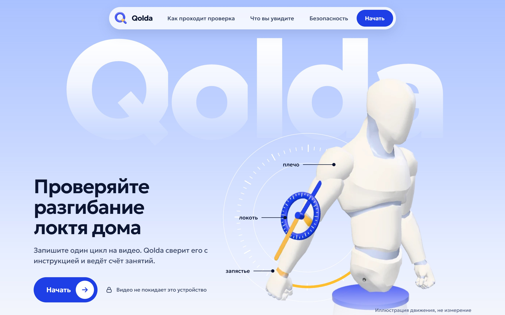 | 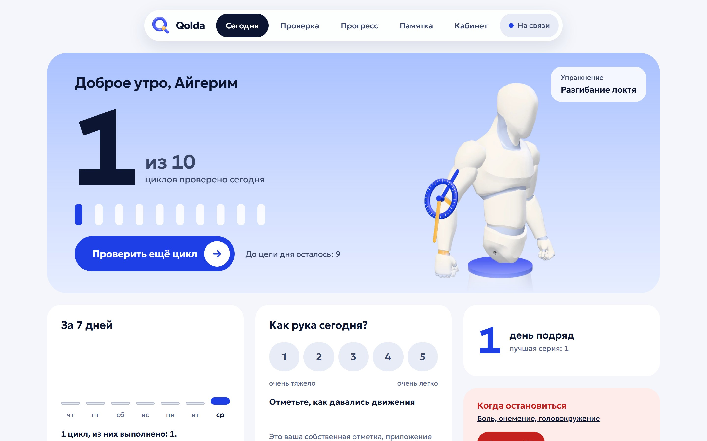 |
| **Check: the video is analysed on the GPU** | **Result** (real engine answer) |
| 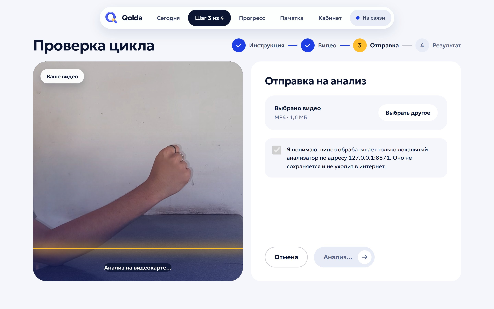 | 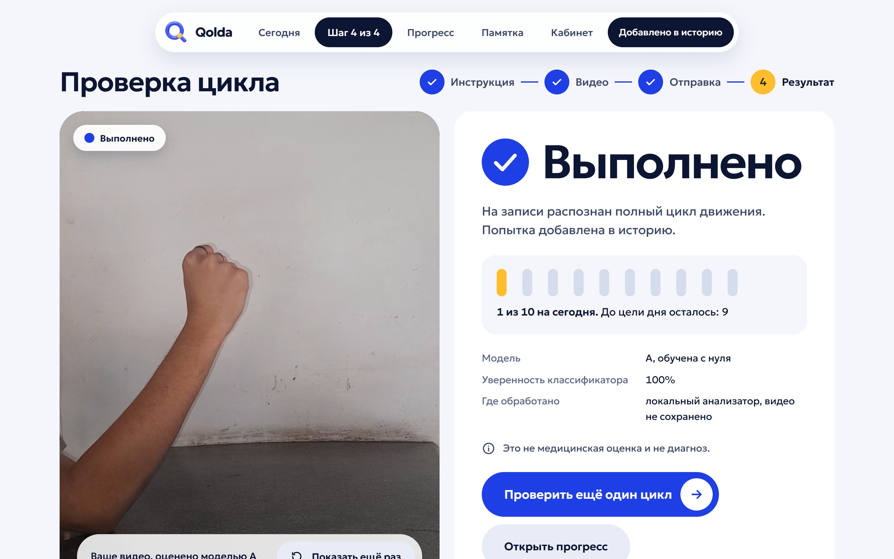 |
| **Progress** | **Guide** |
| 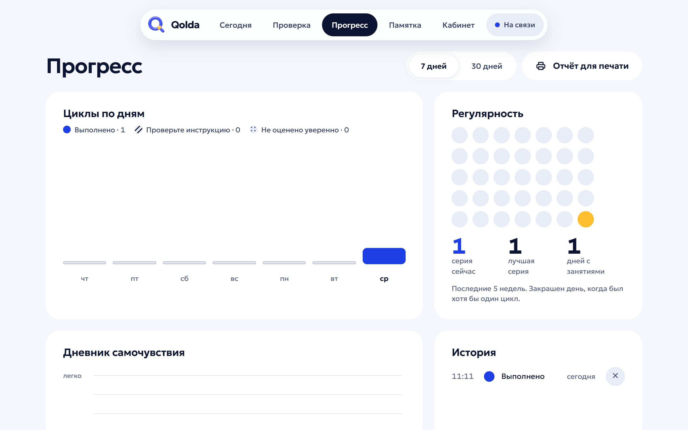 | 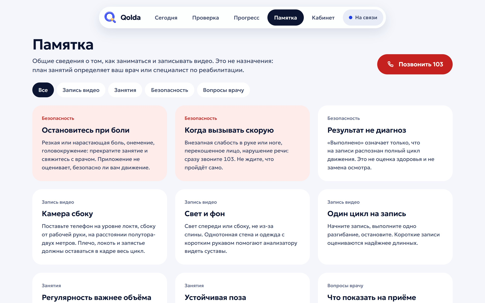 |

**On a phone** (390 px):

<p>
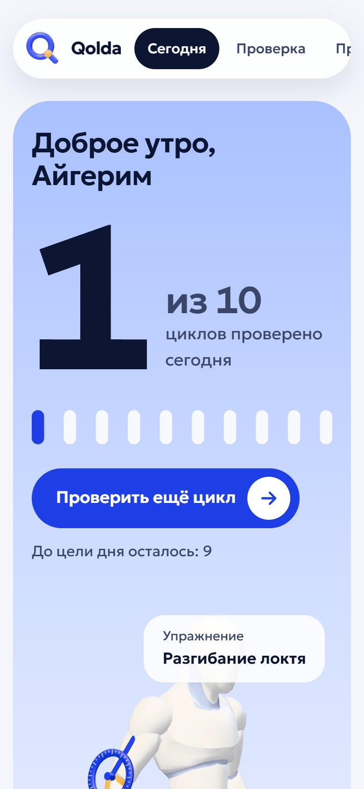
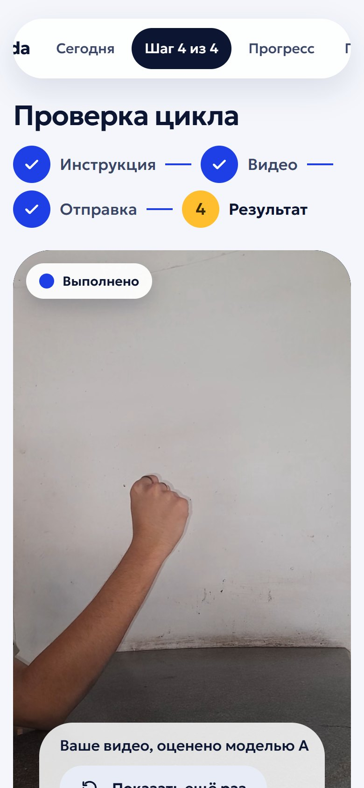
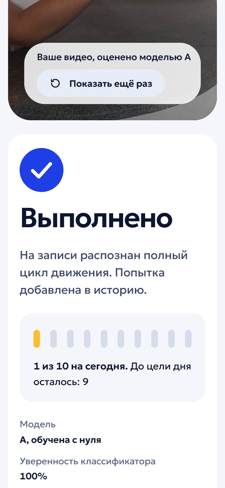
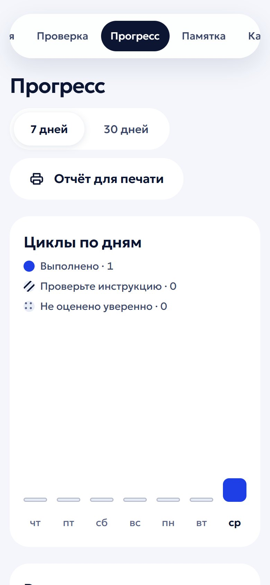
</p>

<sub>The clip in the check and result screens is validation clip <code>05_02_01_01</code> from B. Nair et al., Upper limb stroke rehabilitation exercise video dataset, Mendeley Data V1, CC BY 4.0, <a href="https://doi.org/10.17632/49h9dcwx5v.1">doi:10.17632/49h9dcwx5v.1</a>.</sub>

## How a check works

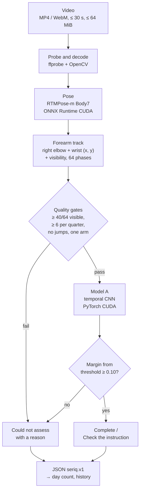

The same pose graph, filters and sampling are used in training and in the app, so the model sees exactly the kind of input it was trained on.

## Architecture

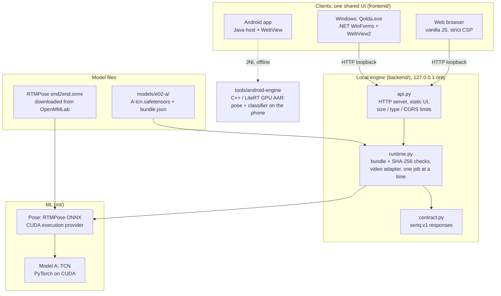

| Part | Folder | Stack | What it does |
|---|---|---|---|
| Web client | [`frontend/`](frontend) | Vanilla ES modules, no bundler, strict CSP | Landing, setup, today, 4-step check, progress, guide, cabinet. The current screens are in [`frontend/src/sky`](frontend/src/sky); [`core/`](frontend/src/core) and [`domain/`](frontend/src/domain) hold the API client, local store and stats. |
| Local engine | [`backend/`](backend) | Python 3.11 standard library HTTP server | Serves the UI and `/api/v1/*`, validates uploads, verifies every model file by SHA-256, runs one analysis at a time. |
| ML | [`ml/`](ml) | PyTorch, ONNX Runtime GPU, OpenCV | Data manifests, pose extraction, quality policy, models, GPU training, scoring. |
| Trained model | [`models/`](models) | safetensors | Model A weights, runtime bundle, training receipt, [model card](models/README.md). |
| Windows | [`desktop/`](desktop) | .NET, WinForms, WebView2 | `Qolda.exe` opens the UI from the local engine in a native window. |
| Android | [`android/`](android), [`tools/android-engine/`](tools/android-engine) | Java, C++, LiteRT GPU delegate | Host app and a native engine that runs pose and classifier on the phone GPU. |
| Tooling | [`tools/`](tools) | Python | Dataset intake, pose download, bundle builder, ONNX / Android export, packaging, smoke tests. |
| Evidence | [`reports/`](reports) | Markdown, JSON | Model evaluations, platform test reports, security and privacy audit. |

A check, request by request:

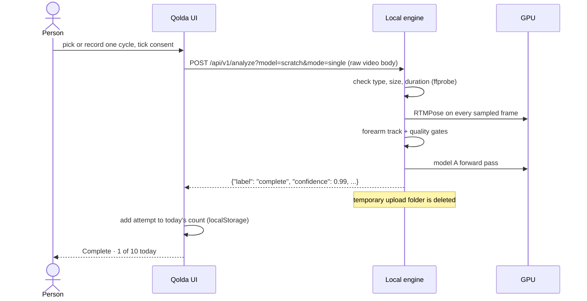

## The model

> Full details: **[model card](models/README.md)** · [evaluation report](reports/ml/forearm-v1/README.md) · [data card](docs/DATA-CARD.md)

**Data.** [Upper limb stroke rehabilitation exercise video dataset](https://doi.org/10.17632/49h9dcwx5v.1) (Nair et al., Mendeley Data V1, CC BY 4.0): 491 clips, 10 volunteers, 4 exercises, one cycle per file, labelled `complete` / `incomplete`. For E02 we split **by person**:

| Split | Volunteers | Clips (incomplete / complete) |
|---|---|---|
| train | ID 01–04 | 77 (47 / 30) |
| validation | ID 05 (unseen person) | 20 (10 / 10) |
| quarantine | – | 10 clips whose folder and file-name labels disagree, excluded |
| sealed test | ID 08 | 20, kept closed |

**Input.** RTMPose finds 17 body keypoints per frame; Qolda keeps only the **right elbow and wrist (x, y)** plus a visibility bit, resampled to **64 phase positions**. The track gets one anchor and one scale per clip, so real motion is preserved. Shoulder visibility in these side-on videos was close to 0 %, which is why the model does not rely on the shoulder or an elbow angle.

**Network.** A temporal CNN trained from scratch, **2 321 parameters**:

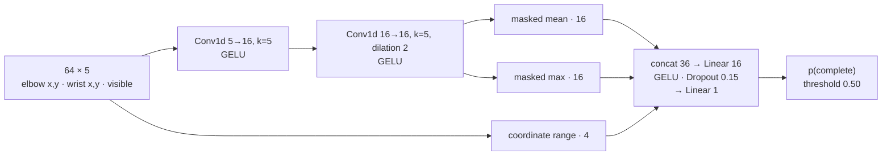

**Training.** AdamW (lr 0.002, weight decay 0.01), class-weighted binary cross-entropy, 36 epochs, batch 8, seed 601. The checkpoint and threshold are chosen on validation by balanced accuracy, then macro-F1, then loss. On an RTX 3060 Laptop GPU the classifier needs about 20 MB of GPU memory; pose extraction is the heavy part.

**Results** of the shipped weights (`e66c0d13…`):

| Split | Scored | Abstained | Balanced accuracy | Macro-F1 |
|---|---|---|---|---|
| train | 71 / 77 | 6, poor forearm visibility | 1.00 | 1.00 |
| validation, unseen person | 20 / 20 | 0 | **1.00** | **1.00** |

- An earlier run of the same recipe on another machine also scored 20 / 20 on the sealed test participant.
- A control trained on the visibility mask alone reached only 0.55 balanced accuracy, so the model uses the movement, not the missing frames.
- Each held-out split is **one person**. Treat these numbers as proof that the pipeline works, not as clinical accuracy.

<details>
<summary><b>Also in the repo: research models for two more exercises</b></summary>

| Exercise | Approach | Development result | Status |
|---|---|---|---|
| E01, lifting an object | RTMPose, both arms, 48 phases, TCN | balanced accuracy 0.86 vs 0.59 baseline on 21 clips of an unseen person ([report](reports/ml/extra-e01.md)) | code and API, weights not shipped |
| E03, wrist extension | small spatio-temporal CNN on RGB frame differences, 24 × 96 × 96 | 1.00 vs 0.50 baseline on 20 clips ([report](reports/ml/extra-e03.md)) | code and API, weights not shipped |
| E02, model B | SLiM skeleton transformer (NTU60 pre-training), last block fine-tuned | same 20 / 20 as A ([report](reports/ml/forearm-v1/README.md)) | not used: A is 2 700× smaller with the same result |

The engine only enables an extra exercise when a reviewed weight file is supplied ([contract](docs/contracts/extra-exercises.md)); otherwise it answers `503` and never substitutes an E02 result.
</details>

## Quick start

### 1. UI only (any computer, no GPU)

Needs Python 3.11+, nothing else.

```powershell
git clone https://github.com/dimik98330/qolda.git
cd qolda
python -B -E -m backend.api --port 8870
```

Open <http://127.0.0.1:8870/>. Every screen works; a check answers *model unavailable* because no model is loaded.

### 2. Full analysis on the GPU

Tested on Windows 11 with an NVIDIA RTX 3060 Laptop and RTX 5060 Ti (driver 617+, CUDA 13 wheels). You also need [`ffprobe.exe`](https://ffmpeg.org/download.html) on `PATH`.

```powershell
# Private folder outside the repo: Python env, pose model, temporary uploads.
$D = Join-Path $HOME 'qolda-private'
py -3.11 -m venv "$D\venv"
$Py = "$D\venv\Scripts\python.exe"
& $Py -m pip install --extra-index-url https://download.pytorch.org/whl/cu130 -r ml/requirements-gpu.txt

# Download RTMPose from OpenMMLab, verify SHA-256, build the static GPU graph.
& $Py -B -m tools.prepare_public_pose --out "$D\pose"
Copy-Item models\e02-a\bundle.json "$D\pose\bundle.json"

# Start the engine with the trained model from this repo.
& $Py -B -m backend.api --port 8870 `
    --bundle "$D\pose\bundle.json" --artifacts models\e02-a `
    --pose-model "$D\pose\end2end.onnx" --private-scratch "$D\scratch" --ffprobe ffprobe.exe
```

Check that the model is loaded, then open <http://127.0.0.1:8870/>:

```powershell
curl.exe http://127.0.0.1:8870/api/v1/health
# {"version":"seriq.v1","models":{"scratch":true,"transfer":false}}
```

Any side-on video of one elbow extension works. To reproduce the demo, take validation clip `05_02_01_01.mp4` from the dataset (see [Train the model](#train-the-model)).

### 3. Run the tests

```powershell
& $Py -m pip install pytest==8.4.2
& $Py -B -m pytest -q -p no:cacheprovider --import-mode=importlib backend ml/tests tools/test_audit_data.py
# 41 passed, 4 skipped (the skipped ones need the optional SLiM base for model B)
```

## Train the model

Everything below runs from the repo root. Datasets, pose caches and checkpoints stay in `$D`, outside Git.

```powershell
# 1. The dataset: Mendeley Data V1, "Download All" (1 248 733 056 bytes).
$Zip = "$D\upper-limb-v1.zip"
curl.exe --fail --location --user-agent "Mozilla/5.0" `
    --referer "https://data.mendeley.com/datasets/49h9dcwx5v/1" --output $Zip `
    "https://data.mendeley.com/public-api/zip/49h9dcwx5v/download/1"

# 2. Select E02 train/validation clips by person, quarantine conflicting labels,
#    check every count and hash. The test participant is never extracted.
& $Py -B -m tools.prepare_extra_development --archive $Zip --selection E02 --out "$D\e02-set"
(Get-FileHash "$D\e02-set\E02\manifest.json").Hash   # 8C73B2A3…6134931

# 3. Train model A on the GPU (pose extraction is cached per clip and resumes).
& $Py -B -m ml.train_gpu --variant A --manifest "$D\e02-set\E02\manifest.json" `
    --root "$D\e02-set\E02" --pose-model "$D\pose\end2end.onnx" `
    --private "$D\A-work" --out "$D\A-run"

# 4. Bind the new weights, pose graph and manifest into a runtime bundle.
& $Py -B -m tools.build_bundle --artifacts "$D\A-run" --name A-tcn.safetensors `
    --pose-model "$D\pose\end2end.onnx" --graph "$D\pose\end2end.b1.onnx" `
    --manifest "$D\e02-set\E02\manifest.json" --source-commit (git rev-parse HEAD) `
    --out "$D\pose\bundle.json"
```

Then start the engine as in Quick start, with `--artifacts "$D\A-run"`. `A-run\receipt.json` records the GPU, library versions, steps, class weights and train / validation metrics. Pose extraction needs about 850 MB of RAM per clip.

Longer guide with E01 / E03 and the exact pins: [docs/TRAINING.md](docs/TRAINING.md) (Russian).

## HTTP API

Contract: [docs/contracts/api.md](docs/contracts/api.md). Samples in [`fixtures/contracts/`](fixtures/contracts) test the exchange only; they are not model output.

| Method | Path | Answer |
|---|---|---|
| `GET` | `/api/v1/health` | `{"version":"seriq.v1","models":{"scratch":true,"transfer":false}}` |
| `POST` | `/api/v1/analyze?model=scratch&mode=single` | Raw `video/mp4` or `video/webm` body, ≤ 64 MiB, ≤ 30 s |

```powershell
curl.exe --data-binary "@one-cycle.mp4" -H "Content-Type: video/mp4" `
    "http://127.0.0.1:8870/api/v1/analyze?model=scratch&mode=single"
```

Real response for validation clip `05_02_01_01`:

```json
{
  "version": "seriq.v1",
  "model": "scratch",
  "model_version": "seriq-e02-forearm-1.0.0+e66c0d137d64",
  "attempts": [{"index": 1, "label": "complete", "confidence": 0.9999973773956299, "reason": null}],
  "counts": {"total": 1, "complete": 1, "incomplete": 0, "uncertain": 0},
  "warnings": []
}
```

`label` is `complete`, `incomplete` or `uncertain` (then `reason` is `low_confidence`, `low_visibility` or `unscorable`). No pose at all gives empty `attempts` and the warning `no_pose`. Errors: `400 invalid_request`, `411`, `413 too_large`, `415 unsupported_media`, `422 invalid_video / duration_limit`, `503 model_unavailable / engine_busy`.

## Windows and Android

| Platform | What is there | Status | Build guide |
|---|---|---|---|
| **Web** | The engine serves the UI at `127.0.0.1:8870` | Works end to end with real GPU analysis (screens and GIF above) | this README |
| **Windows** | `Qolda.exe`: .NET WinForms + WebView2 window over the same engine. `Qolda.exe --attach-port 8870` opens a running engine | Built and launched with the CUDA engine on Windows 11 ([report](reports/platforms/windows-candidate.md)) | [docs/BUILD-WINDOWS.md](docs/BUILD-WINDOWS.md) |
| **Android** | Host app `net.qolda.offline` (API 28+, arm64) and a C++ AAR that runs RTMPose and the classifier through the LiteRT GPU delegate, fully offline | Engine verified on a OnePlus CPH2399 (Mali-G77) with every node on the GPU ([report](reports/ml/gpu-handoff/M4.1-android-device.md)). A debug APK with model A and the new UI wired to the native bridge is built from this repo and passes the package checks; a run on a phone is next | [docs/BUILD-ANDROID.md](docs/BUILD-ANDROID.md) |

## Repository layout

```text
qolda/
├── backend/            local HTTP engine: API, runtime, response contract, tests
├── ml/                 data manifests, pose extraction, models, GPU training, scoring, tests
├── models/
│   ├── README.md       model card
│   └── e02-a/          trained model A: weights, runtime bundle, training receipt and report
├── frontend/           web client (src/sky = current screens, src/core = API client and store)
├── assets/             logo, fonts, 3D mannequin, three.js
├── desktop/            Windows app (C#, WebView2)
├── android/            Android host app (Java)
├── tools/              dataset intake, pose download, bundle builder, exports, packaging, smoke tests
│   └── android-engine/ native Android GPU engine (C++, LiteRT)
├── fixtures/contracts/ API exchange samples
├── docs/               spec, architecture, data card, contracts, training and build guides, media
├── reports/            ML evaluations, platform test reports, security audit
├── artifacts/seriq/    third-party attribution and licences
└── infra/serve.ps1     helper to start or verify the local web
```

## Privacy, safety and ethics

- **Local only.** The engine binds to loopback, accepts uploads only from its own origin and a short list of local dev origins, stores the upload in a temporary folder that is removed after the request, and sends no telemetry. No account, no server database.
- **Explicit consent** before each upload; the person's name, goal and history live in the browser's local storage and can be exported or wiped from the cabinet.
- **Neutral results.** Each result uses a word, an icon and a pattern, never colour alone. No angles in degrees, no scores, no diagnoses. Red appears only for *when to stop*: pain, numbness, dizziness.
- **Honest failure.** *Could not assess* is a first-class answer; `503` if the model or GPU is missing; no cloud fallback.
- **Data in Git.** No raw videos, frames, pose arrays, participant IDs, keys or home paths. The only weights are model A's 11 KB file.
- Audit: [reports/security/prototype-audit.md](reports/security/prototype-audit.md) · [release snapshot](reports/security/release-snapshot.md).

## Limitations

- A hackathon prototype, **not a medical device** and not a substitute for a therapist.
- One exercise (E02), right arm, side-on camera, one person in frame.
- Validated on one unseen person (20 clips). Real homes differ from the dataset's setting.
- Full analysis needs an NVIDIA GPU; there is deliberately no CPU fallback in the shipped engine.

## Documentation

Detailed docs are in Russian.

| Topic | File |
|---|---|
| Specification | [docs/SPEC.md](docs/SPEC.md) |
| Architecture notes | [docs/ARCHITECTURE.md](docs/ARCHITECTURE.md) |
| Data card | [docs/DATA-CARD.md](docs/DATA-CARD.md) |
| A vs B evaluation protocol | [docs/MODEL-EVALUATION.md](docs/MODEL-EVALUATION.md) |
| Sources, licences, research decisions | [docs/RESEARCH.md](docs/RESEARCH.md) |
| Training from a clean clone | [docs/TRAINING.md](docs/TRAINING.md) |
| Windows / Android builds | [docs/BUILD-WINDOWS.md](docs/BUILD-WINDOWS.md) · [docs/BUILD-ANDROID.md](docs/BUILD-ANDROID.md) · [E03 add-on](docs/BUILD-WINDOWS-E03.md) |
| Contracts: API, UI, data, live camera, extra exercises | [docs/contracts/](docs/contracts) |
| ML internals (English) | [ml/README.md](ml/README.md) |
| Web client and design | [frontend/README.md](frontend/README.md) · [frontend/DESIGN.md](frontend/DESIGN.md) |

## Credits and licences

- **Dataset:** B. Nair, S. Nandana, M. Thenmozhi Dharshini, V. Viswanathan. *An upper limb stroke rehabilitation exercise video dataset.* Mendeley Data, V1. [doi:10.17632/49h9dcwx5v.1](https://doi.org/10.17632/49h9dcwx5v.1), CC BY 4.0. Model A is trained on it; the demo shows one of its validation clips with this attribution in frame.
- **Pose:** [RTMPose](https://github.com/open-mmlab/mmpose/tree/main/projects/rtmpose), OpenMMLab, Apache-2.0. Downloaded at setup, not redistributed.
- **SLiM** (model B research): [KAIST-VICLab/SLiM](https://github.com/KAIST-VICLab/SLiM), Apache-2.0, see [artifacts/seriq](artifacts/seriq/ATTRIBUTION.md).
- **3D mannequin:** *Animated Base Character* by Quaternius, [CC BY 3.0](https://creativecommons.org/licenses/by/3.0/) ([credits](assets/models/CREDITS.md)); the screens show renders of it · **three.js:** MIT · **Geologica** font: SIL OFL 1.1.
- Case and brief: [AI-Sana Shakarim Solveathon](https://solveathon.shakarim.edu.kz/), SerIQ.
