<div align="center">

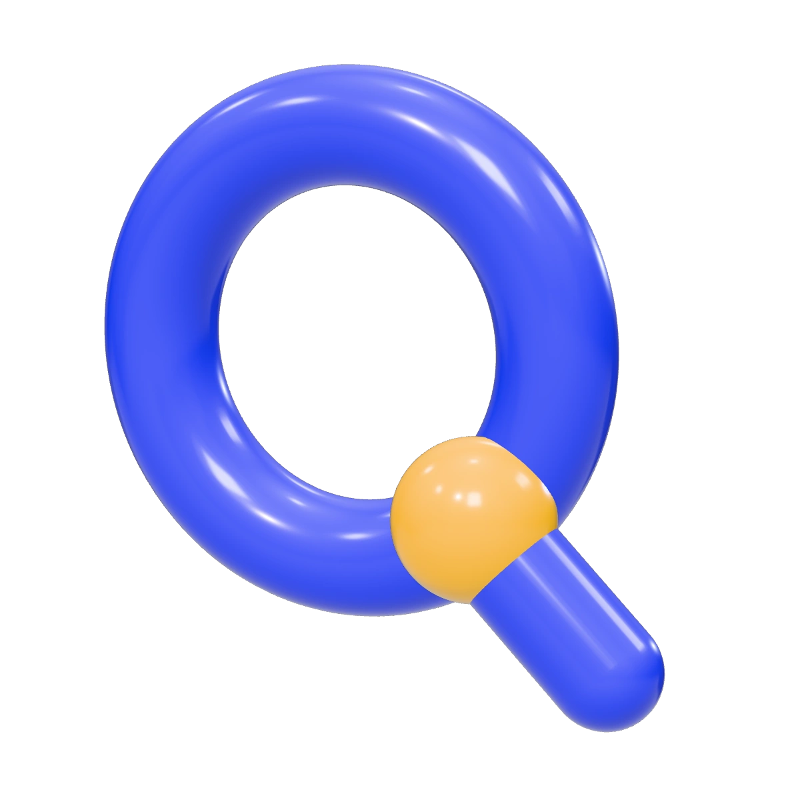

# Qolda

**Проверка одного разгибания локтя дома. Видео не покидает компьютер.**

*Кейс SerIQ · AI-Sana Shakarim Solveathon 2026*

[English](README.md) · **Русский**


<sub>Настоящий прогон: проверочный клип из открытого датасета уходит на локальный движок с GPU и возвращается с ответом <b>«Выполнено»</b>. Полный ролик на 1:52 с озвучкой: <a href="docs/media/qolda-demo.mp4">docs/media/qolda-demo.mp4</a>.</sub>

</div>

---

## Содержание

- [Что это](#что-это)
- [Экраны](#экраны)
- [Как проходит проверка](#как-проходит-проверка)
- [Архитектура](#архитектура)
- [Модель](#модель)
- [Быстрый старт](#быстрый-старт)
- [Как обучить модель](#как-обучить-модель)
- [HTTP API](#http-api)
- [Windows и Android](#windows-и-android)
- [Структура репозитория](#структура-репозитория)
- [Приватность, безопасность и этика](#приватность-безопасность-и-этика)
- [Ограничения](#ограничения)
- [Документация](#документация)
- [Источники и лицензии](#источники-и-лицензии)

## Что это

После инсульта люди неделями повторяют дома простые упражнения для руки, и обычно рядом нет никого, кто скажет, засчитан ли повтор. Qolda (по-казахски «в руке», «поддержи») закрывает этот разрыв для одного упражнения, **E02 — разгибание локтя**.

1. Человек садится боком к камере и записывает **один цикл** (или выбирает готовый файл до 30 секунд).
2. **Локальный движок** на видеокарте находит локоть и запястье в каждом кадре с помощью RTMPose, проверяет, что траектории достаточно для оценки, и небольшая временная сеть решает, был ли цикл **полным**.
3. Ответ всегда нейтральный: **«Выполнено»**, **«Проверьте инструкцию»** или **«Не удалось оценить»**. Полный цикл закрашивает одно деление дневной цели; прогресс, серия и дневник самочувствия хранятся в браузере.

Чем отличается:

- **Ничего не уходит в облако.** Движок слушает только `127.0.0.1`, держит загрузку во временной папке на время одного запроса и не возвращает кадры, координаты или имена файлов.
- **Модель обучена нами**, с нуля, с разбиением по людям, закреплённым манифестом данных и квитанцией обучения. Веса лежат в репозитории: [`models/e02-a`](models/e02-a).
- **Умеет сказать «не знаю».** Плохая видимость, вторая рука в кадре или слишком слабое движение дают «Не удалось оценить» с причиной, а не ложное «Не выполнено».
- **Строго GPU.** Если нет CUDA или весов, движок отвечает `model_unavailable`, а не подменяет модель более медленной или другой.
- **Один интерфейс, три поверхности:** веб (его отдаёт сам движок), приложение для Windows (`Qolda.exe`, WebView2) и Android-приложение с нативным GPU-движком.

## Экраны

| Первый экран | Сегодня |
|---|---|
| 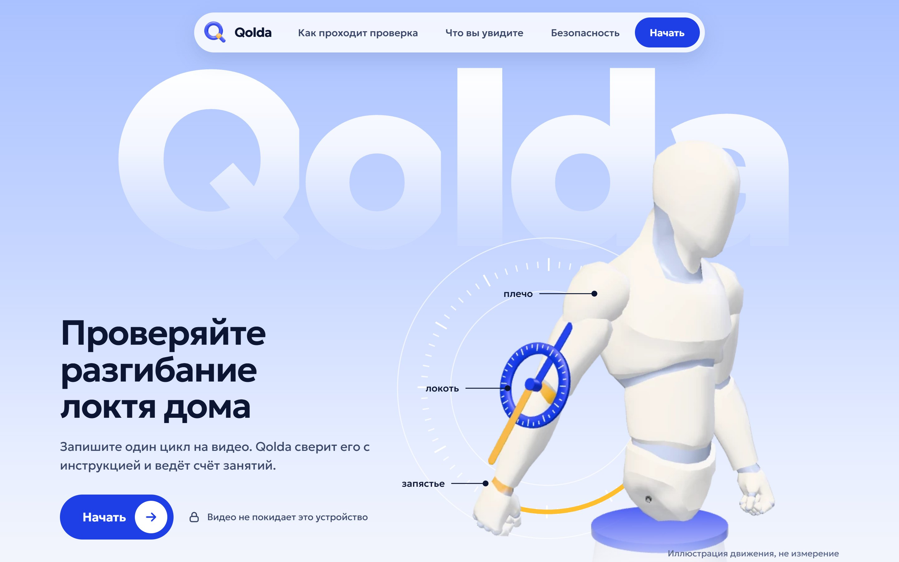 | 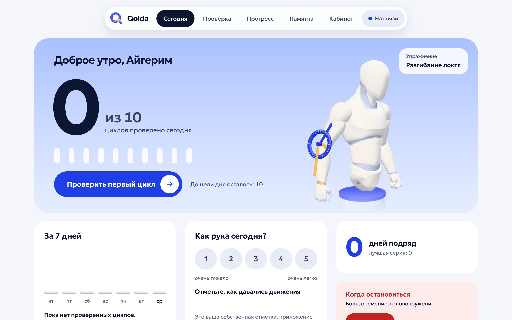 |
| **Проверка: инструкция** | **Проверка: результат** (настоящий ответ движка) |
| 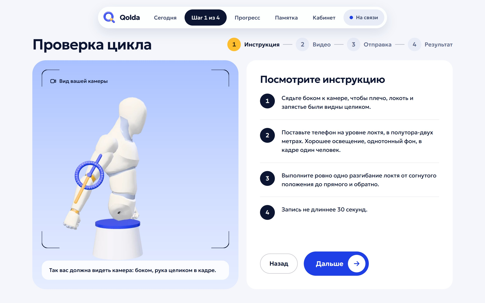 | 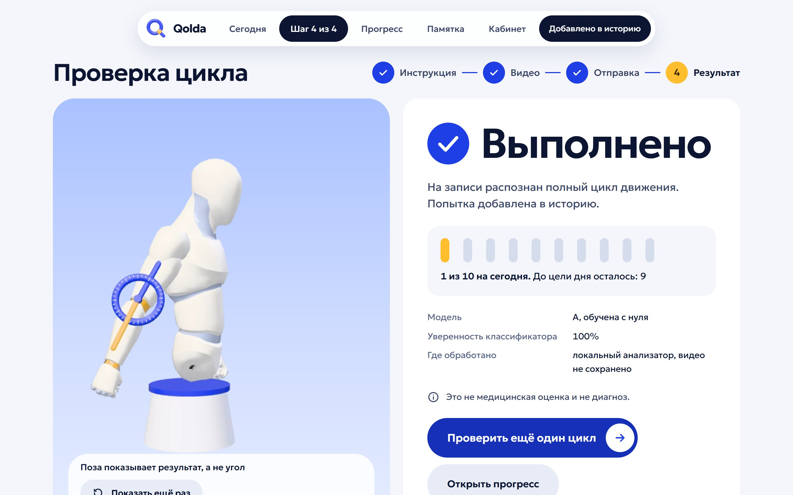 |
| **Прогресс** | **Памятка** |
| 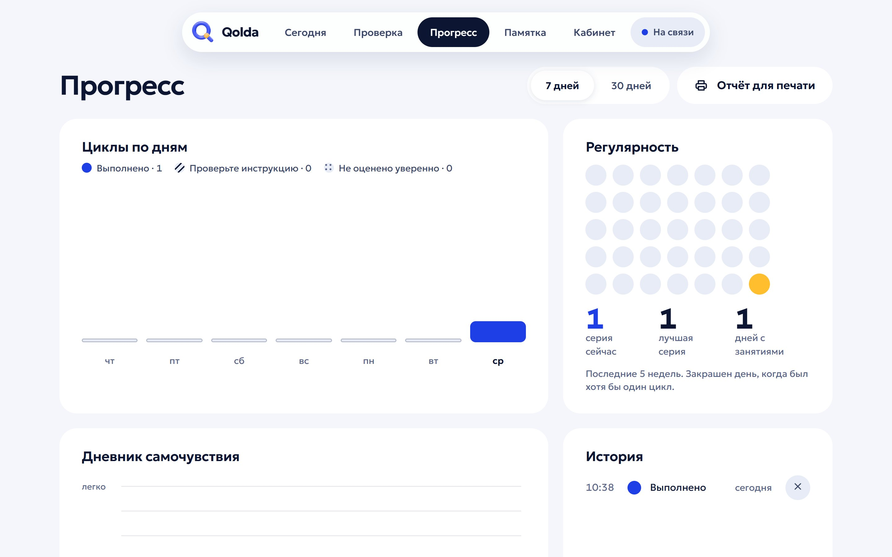 | 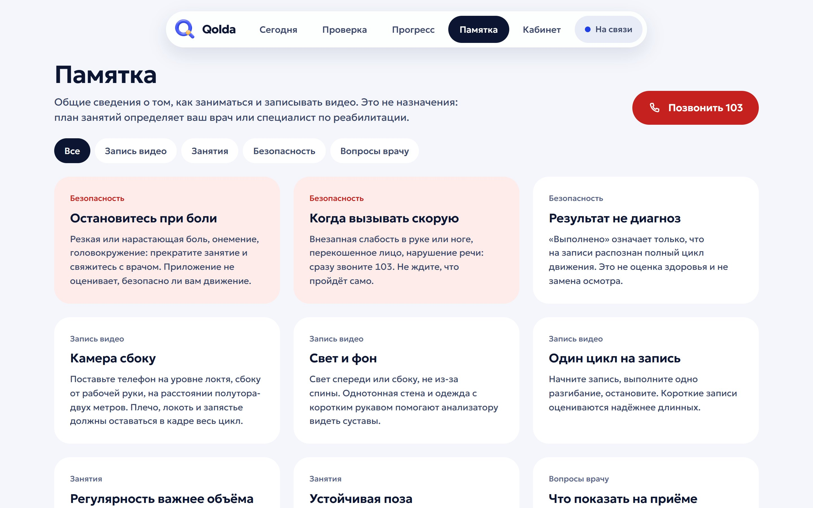 |

## Как проходит проверка

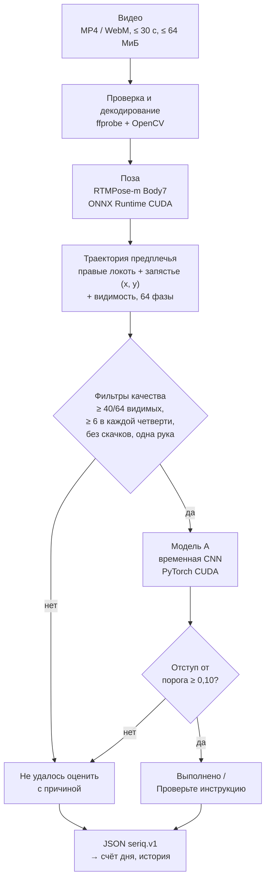

В обучении и в приложении используются один и тот же граф позы, те же фильтры и та же выборка фаз, поэтому модель получает ровно такой вход, на котором обучалась.

## Архитектура

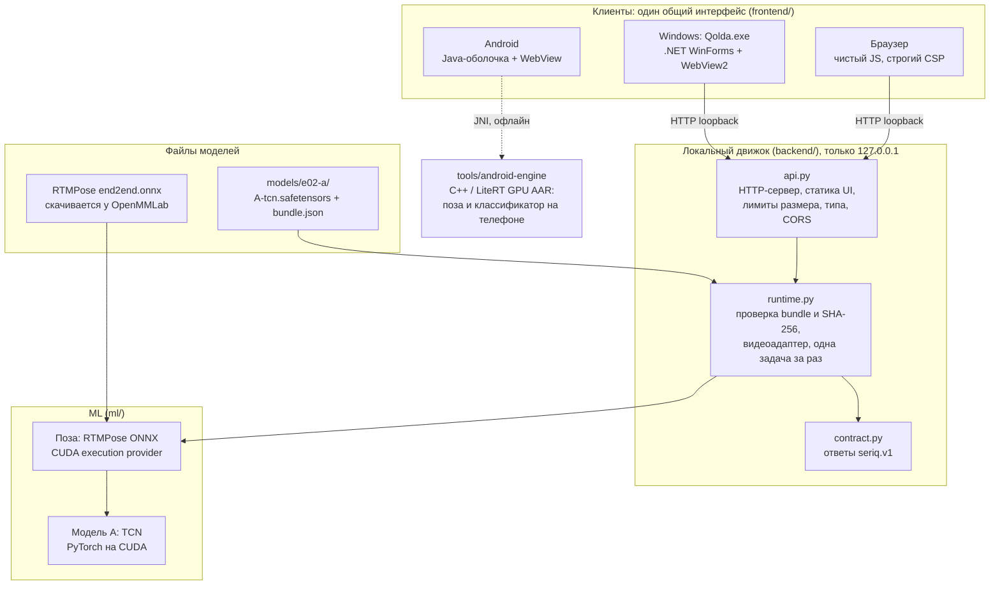

| Часть | Папка | Стек | Что делает |
|---|---|---|---|
| Веб-клиент | [`frontend/`](frontend) | ES-модули без сборщика, строгий CSP | Первый экран, настройка, «Сегодня», проверка в 4 шага, прогресс, памятка, кабинет. Текущие экраны — в [`frontend/src/sky`](frontend/src/sky); в [`core/`](frontend/src/core) и [`domain/`](frontend/src/domain) клиент API, локальное хранилище и статистика. |
| Локальный движок | [`backend/`](backend) | HTTP-сервер на стандартной библиотеке Python 3.11 | Отдаёт UI и `/api/v1/*`, проверяет загрузки, сверяет каждый файл модели по SHA-256, выполняет один анализ за раз. |
| ML | [`ml/`](ml) | PyTorch, ONNX Runtime GPU, OpenCV | Манифесты данных, извлечение позы, политика качества, модели, обучение на GPU, метрики. |
| Обученная модель | [`models/`](models) | safetensors | Веса модели A, bundle для движка, квитанция обучения, [карточка модели](models/README.md). |
| Windows | [`desktop/`](desktop) | .NET, WinForms, WebView2 | `Qolda.exe` открывает интерфейс локального движка в нативном окне. |
| Android | [`android/`](android), [`tools/android-engine/`](tools/android-engine) | Java, C++, LiteRT GPU delegate | Приложение-оболочка и нативный движок: поза и классификатор на GPU телефона. |
| Инструменты | [`tools/`](tools) | Python | Отбор данных, загрузка позы, сборка bundle, экспорт ONNX / Android, упаковка, smoke-тесты. |
| Доказательства | [`reports/`](reports) | Markdown, JSON | Оценки моделей, отчёты проверок платформ, аудит безопасности и приватности. |

Одна проверка по шагам:

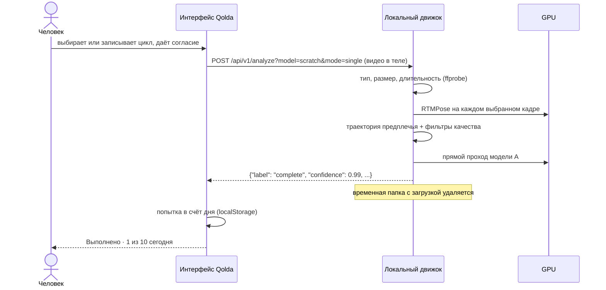

## Модель

> Подробно: **[карточка модели](models/README.md)** · [отчёт об оценке](reports/ml/forearm-v1/README.md) · [паспорт данных](docs/DATA-CARD.md)

**Данные.** [Upper limb stroke rehabilitation exercise video dataset](https://doi.org/10.17632/49h9dcwx5v.1) (Nair et al., Mendeley Data V1, CC BY 4.0): 491 клип, 10 добровольцев, 4 упражнения, один цикл на файл, разметка авторов `complete` / `incomplete`. Для E02 делим **по людям**:

| Выборка | Добровольцы | Клипы (incomplete / complete) |
|---|---|---|
| train | ID 01–04 | 77 (47 / 30) |
| validation | ID 05, человек, которого модель не видела | 20 (10 / 10) |
| карантин | – | 10 клипов, где метка папки и имени файла расходятся, исключены |
| закрытый test | ID 08 | 20, не открывается |

**Вход.** RTMPose находит 17 ключевых точек тела на кадр; Qolda берёт только **правые локоть и запястье (x, y)** и признак видимости, приведённые к **64 фазам**. На клип одна точка привязки и один масштаб, поэтому реальное движение сохраняется. Плечо на этих боковых съёмках видно почти никогда (около 0 %), поэтому модель не опирается ни на плечо, ни на угол в локте.

**Сеть.** Временная свёрточная сеть, обученная с нуля, **2 321 параметр**:

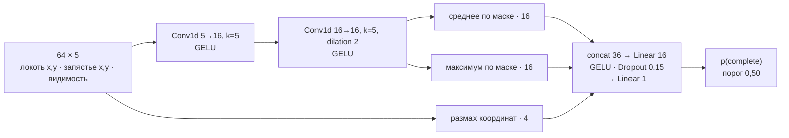

**Обучение.** AdamW (lr 0,002, weight decay 0,01), бинарная кросс-энтропия с весами классов, 36 эпох, batch 8, seed 601. Чекпойнт и порог выбираются на validation: balanced accuracy, затем macro-F1, затем loss. На RTX 3060 Laptop классификатору нужно около 20 МБ видеопамяти; основная нагрузка — извлечение позы.

**Результаты** весов из репозитория (`e66c0d13…`):

| Выборка | Оценено | Отказов | Balanced accuracy | Macro-F1 |
|---|---|---|---|---|
| train | 71 / 77 | 6, плохо видно предплечье | 1,00 | 1,00 |
| validation, новый человек | 20 / 20 | 0 | **1,00** | **1,00** |

- Более ранний прогон того же рецепта на другом компьютере дал 20 / 20 и на закрытом тестовом добровольце.
- Контрольная модель, обученная только на маске видимости, дала лишь 0,55 balanced accuracy: модель смотрит на движение, а не на пропущенные кадры.
- Каждая отложенная выборка — **один человек**. Это доказательство работоспособности пайплайна, а не клиническая точность.

<details>
<summary><b>Ещё в репозитории: исследовательские модели для двух упражнений</b></summary>

| Упражнение | Подход | Результат на разработке | Статус |
|---|---|---|---|
| E01, подъём предмета | RTMPose, обе руки, 48 фаз, TCN | balanced accuracy 0,86 против 0,59 у baseline на 21 клипе нового человека ([отчёт](reports/ml/extra-e01.md)) | код и API, веса не входят |
| E03, разгибание запястья | малая пространственно-временная CNN по разностям RGB-кадров, 24 × 96 × 96 | 1,00 против 0,50 на 20 клипах ([отчёт](reports/ml/extra-e03.md)) | код и API, веса не входят |
| E02, модель B | скелетный трансформер SLiM (предобучен на NTU60), дообучен последний блок | те же 20 / 20, что у A ([отчёт](reports/ml/forearm-v1/README.md)) | не используется: A в 2 700 раз меньше при том же результате |

Движок включает дополнительное упражнение, только когда передан проверенный файл весов ([контракт](docs/contracts/extra-exercises.md)); иначе отвечает `503` и никогда не подставляет результат E02.
</details>

## Быстрый старт

### 1. Только интерфейс (любой компьютер, без GPU)

Нужен только Python 3.11+.

```powershell
git clone https://github.com/dimik98330/qolda.git
cd qolda
python -B -E -m backend.api --port 8870
```

Откройте <http://127.0.0.1:8870/>. Все экраны работают; проверка ответит «модель недоступна», потому что модель не загружена.

### 2. Полный анализ на GPU

Проверено на Windows 11 с NVIDIA RTX 3060 Laptop и RTX 5060 Ti (драйвер 617+, колёса CUDA 13). Также нужен [`ffprobe.exe`](https://ffmpeg.org/download.html) в `PATH`.

```powershell
# Приватная папка вне репозитория: окружение Python, модель позы, временные загрузки.
$D = Join-Path $HOME 'qolda-private'
py -3.11 -m venv "$D\venv"
$Py = "$D\venv\Scripts\python.exe"
& $Py -m pip install --extra-index-url https://download.pytorch.org/whl/cu130 -r ml/requirements-gpu.txt

# Скачать RTMPose у OpenMMLab, проверить SHA-256, собрать статический граф для GPU.
& $Py -B -m tools.prepare_public_pose --out "$D\pose"
Copy-Item models\e02-a\bundle.json "$D\pose\bundle.json"

# Запустить движок с обученной моделью из репозитория.
& $Py -B -m backend.api --port 8870 `
    --bundle "$D\pose\bundle.json" --artifacts models\e02-a `
    --pose-model "$D\pose\end2end.onnx" --private-scratch "$D\scratch" --ffprobe ffprobe.exe
```

Убедитесь, что модель загружена, и откройте <http://127.0.0.1:8870/>:

```powershell
curl.exe http://127.0.0.1:8870/api/v1/health
# {"version":"seriq.v1","models":{"scratch":true,"transfer":false}}
```

Подойдёт любое видео одного разгибания локтя, снятое сбоку. Чтобы повторить демо, возьмите из датасета проверочный клип `05_02_01_01.mp4` (см. [Как обучить модель](#как-обучить-модель)).

### 3. Тесты

```powershell
& $Py -m pip install pytest==8.4.2
& $Py -B -m pytest -q -p no:cacheprovider --import-mode=importlib backend ml/tests tools/test_audit_data.py
# 41 passed, 4 skipped (пропущенным нужна необязательная база SLiM для модели B)
```

## Как обучить модель

Всё запускается из корня репозитория. Датасет, кэш позы и чекпойнты остаются в `$D`, вне Git.

```powershell
# 1. Датасет: Mendeley Data V1, «Download All» (1 248 733 056 байт).
$Zip = "$D\upper-limb-v1.zip"
curl.exe --fail --location --user-agent "Mozilla/5.0" `
    --referer "https://data.mendeley.com/datasets/49h9dcwx5v/1" --output $Zip `
    "https://data.mendeley.com/public-api/zip/49h9dcwx5v/download/1"

# 2. Отобрать клипы E02 train/validation по людям, убрать в карантин противоречивые метки,
#    сверить количества и хэши. Тестовый доброволец не извлекается.
& $Py -B -m tools.prepare_extra_development --archive $Zip --selection E02 --out "$D\e02-set"
(Get-FileHash "$D\e02-set\E02\manifest.json").Hash   # 8C73B2A3…6134931

# 3. Обучить модель A на GPU (поза кэшируется по клипам, прерванный запуск продолжается).
& $Py -B -m ml.train_gpu --variant A --manifest "$D\e02-set\E02\manifest.json" `
    --root "$D\e02-set\E02" --pose-model "$D\pose\end2end.onnx" `
    --private "$D\A-work" --out "$D\A-run"

# 4. Связать новые веса, граф позы и манифест в bundle для движка.
& $Py -B -m tools.build_bundle --artifacts "$D\A-run" --name A-tcn.safetensors `
    --pose-model "$D\pose\end2end.onnx" --graph "$D\pose\end2end.b1.onnx" `
    --manifest "$D\e02-set\E02\manifest.json" --source-commit (git rev-parse HEAD) `
    --out "$D\pose\bundle.json"
```

Затем запустите движок, как в быстром старте, с `--artifacts "$D\A-run"`. В `A-run\receipt.json` записаны GPU, версии библиотек, шаги, веса классов и метрики train / validation. Извлечение позы требует около 850 МБ оперативной памяти на клип.

Подробная инструкция с E01 / E03 и всеми контрольными суммами: [docs/TRAINING.md](docs/TRAINING.md).

## HTTP API

Контракт: [docs/contracts/api.md](docs/contracts/api.md). Примеры в [`fixtures/contracts/`](fixtures/contracts) проверяют только обмен и не являются ответами модели.

| Метод | Путь | Ответ |
|---|---|---|
| `GET` | `/api/v1/health` | `{"version":"seriq.v1","models":{"scratch":true,"transfer":false}}` |
| `POST` | `/api/v1/analyze?model=scratch&mode=single` | Тело — сам файл `video/mp4` или `video/webm`, ≤ 64 МиБ, ≤ 30 с |

```powershell
curl.exe --data-binary "@one-cycle.mp4" -H "Content-Type: video/mp4" `
    "http://127.0.0.1:8870/api/v1/analyze?model=scratch&mode=single"
```

Настоящий ответ на проверочный клип `05_02_01_01`:

```json
{
  "version": "seriq.v1",
  "model": "scratch",
  "model_version": "seriq-e02-forearm-1.0.0+e66c0d137d64",
  "attempts": [{"index": 1, "label": "complete", "confidence": 0.9999973773956299, "reason": null}],
  "counts": {"total": 1, "complete": 1, "incomplete": 0, "uncertain": 0},
  "warnings": []
}
```

`label` — `complete`, `incomplete` или `uncertain` (тогда `reason` — `low_confidence`, `low_visibility` или `unscorable`). Если поза не найдена совсем, `attempts` пустой и есть предупреждение `no_pose`. Ошибки: `400 invalid_request`, `411`, `413 too_large`, `415 unsupported_media`, `422 invalid_video / duration_limit`, `503 model_unavailable / engine_busy`.

## Windows и Android

| Платформа | Что есть | Статус | Инструкция по сборке |
|---|---|---|---|
| **Веб** | Движок отдаёт интерфейс на `127.0.0.1:8870` | Работает целиком, с настоящим анализом на GPU (скриншоты и GIF выше) | этот README |
| **Windows** | `Qolda.exe`: окно .NET WinForms + WebView2 поверх того же движка. `Qolda.exe --attach-port 8870` подключается к уже запущенному движку | Собрано и запущено вместе с CUDA-движком на Windows 11 ([отчёт](reports/platforms/windows-candidate.md)) | [docs/BUILD-WINDOWS.md](docs/BUILD-WINDOWS.md) |
| **Android** | Приложение `net.qolda.offline` (API 28+, arm64) и C++ AAR, который через LiteRT GPU delegate запускает RTMPose и классификатор полностью офлайн | Движок проверен на OnePlus CPH2399 (Mali-G77), все узлы на GPU ([отчёт](reports/ml/gpu-handoff/M4.1-android-device.md)); новый интерфейс ещё не подключён к нативному мосту | [docs/BUILD-ANDROID.md](docs/BUILD-ANDROID.md) |

## Структура репозитория

```text
qolda/
├── backend/            локальный HTTP-движок: API, runtime, контракт ответа, тесты
├── ml/                 манифесты данных, извлечение позы, модели, обучение на GPU, метрики, тесты
├── models/
│   ├── README.md       карточка модели
│   └── e02-a/          обученная модель A: веса, bundle, квитанция и отчёт обучения
├── frontend/           веб-клиент (src/sky — текущие экраны, src/core — клиент API и хранилище)
├── assets/             логотип, шрифты, 3D-манекен, three.js
├── desktop/            приложение для Windows (C#, WebView2)
├── android/            Android-оболочка (Java)
├── tools/              отбор данных, загрузка позы, сборка bundle, экспорт, упаковка, smoke-тесты
│   └── android-engine/ нативный GPU-движок для Android (C++, LiteRT)
├── fixtures/contracts/ примеры обмена с API
├── docs/               ТЗ, архитектура, паспорт данных, контракты, обучение и сборка, медиа
├── reports/            оценки моделей, отчёты проверок платформ, аудит безопасности
├── artifacts/seriq/    атрибуция и лицензии сторонних компонентов
└── infra/serve.ps1     запуск и проверка локального веба
```

## Приватность, безопасность и этика

- **Только локально.** Движок слушает loopback, принимает загрузки только со своего origin и короткого списка локальных dev-адресов, хранит файл во временной папке, которая удаляется после запроса, и не шлёт телеметрию. Нет аккаунта и серверной базы.
- **Явное согласие** перед каждой отправкой; имя, цель и история хранятся в localStorage браузера, их можно скачать или удалить в кабинете.
- **Нейтральные результаты.** У каждого результата есть слово, значок и узор, не только цвет. Нет градусов, баллов и диагнозов. Красный цвет — только для «когда остановиться»: боль, онемение, головокружение.
- **Честный отказ.** «Не удалось оценить» — полноценный ответ; `503`, если нет модели или GPU; никакого запасного облака.
- **Данные в Git.** Нет сырых видео, кадров, массивов позы, ID участников, ключей и домашних путей. Единственные веса — файл модели A на 11 КБ.
- Аудит: [reports/security/prototype-audit.md](reports/security/prototype-audit.md) · [срез релиза](reports/security/release-snapshot.md).

## Ограничения

- Прототип хакатона, **не медицинское изделие** и не замена реабилитолога.
- Одно упражнение (E02), правая рука, камера сбоку, один человек в кадре.
- Проверено на одном новом человеке (20 клипов). Дома условия отличаются от съёмки датасета.
- Для полного анализа нужна NVIDIA GPU; запасного режима на CPU в поставке нет намеренно.

## Документация

| Тема | Файл |
|---|---|
| Техническое задание | [docs/SPEC.md](docs/SPEC.md) |
| Заметки об архитектуре | [docs/ARCHITECTURE.md](docs/ARCHITECTURE.md) |
| Паспорт данных | [docs/DATA-CARD.md](docs/DATA-CARD.md) |
| Протокол сравнения A и B | [docs/MODEL-EVALUATION.md](docs/MODEL-EVALUATION.md) |
| Источники, лицензии, решения | [docs/RESEARCH.md](docs/RESEARCH.md) |
| Обучение с чистого клона | [docs/TRAINING.md](docs/TRAINING.md) |
| Сборка Windows / Android | [docs/BUILD-WINDOWS.md](docs/BUILD-WINDOWS.md) · [docs/BUILD-ANDROID.md](docs/BUILD-ANDROID.md) · [дополнение E03](docs/BUILD-WINDOWS-E03.md) |
| Контракты: API, UI, данные, живая камера, доп. упражнения | [docs/contracts/](docs/contracts) |
| Внутреннее устройство ML (англ.) | [ml/README.md](ml/README.md) |
| Веб-клиент и дизайн | [frontend/README.md](frontend/README.md) · [frontend/DESIGN.md](frontend/DESIGN.md) |

## Источники и лицензии

- **Датасет:** B. Nair, S. Nandana, M. Thenmozhi Dharshini, V. Viswanathan. *An upper limb stroke rehabilitation exercise video dataset.* Mendeley Data, V1. [doi:10.17632/49h9dcwx5v.1](https://doi.org/10.17632/49h9dcwx5v.1), CC BY 4.0. На нём обучена модель A; в демо показан один его проверочный клип с этой подписью в кадре.
- **Поза:** [RTMPose](https://github.com/open-mmlab/mmpose/tree/main/projects/rtmpose), OpenMMLab, Apache-2.0. Скачивается при установке, в репозитории не распространяется.
- **SLiM** (исследование модели B): [KAIST-VICLab/SLiM](https://github.com/KAIST-VICLab/SLiM), Apache-2.0, см. [artifacts/seriq](artifacts/seriq/ATTRIBUTION.md).
- **3D-манекен:** *Animated Base Character*, Quaternius, [CC BY 3.0](https://creativecommons.org/licenses/by/3.0/) ([источник](assets/models/CREDITS.md)); на экранах его рендеры · **three.js:** MIT · шрифт **Geologica:** SIL OFL 1.1.
- Кейс и ТЗ: [AI-Sana Shakarim Solveathon](https://solveathon.shakarim.edu.kz/), SerIQ.
